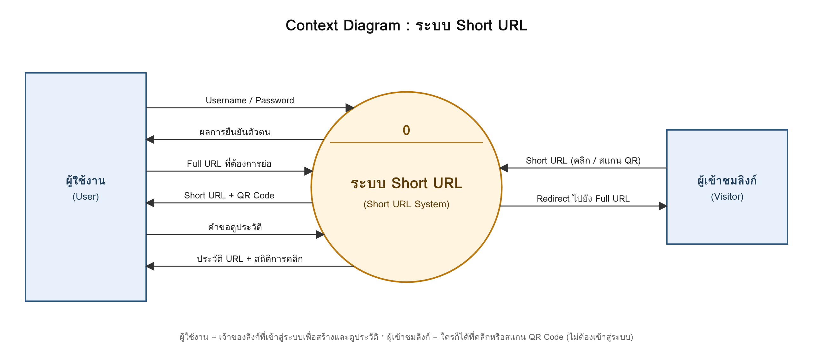
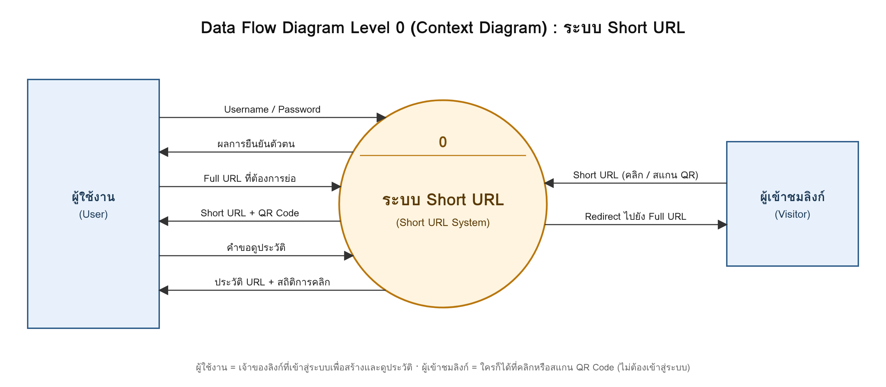
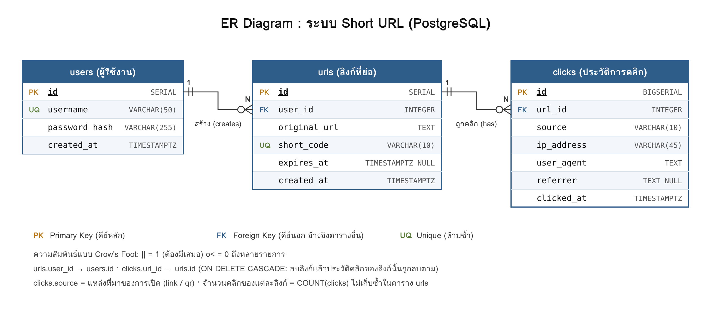
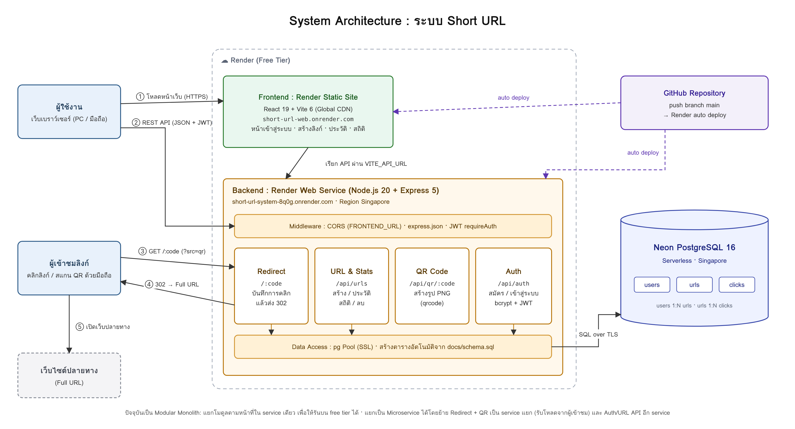

# short-url-system

ระบบย่อลิงก์ (Short URL) พร้อม QR Code และสถิติการคลิก พัฒนาด้วย Node.js + React + PostgreSQL

## 🔗 ทดลองใช้งานออนไลน์

| รายการ | ข้อมูล |
|---|---|
| **เว็บไซต์** | https://short-url-web.onrender.com |
| **API (Backend)** | https://short-url-system-8q0g.onrender.com |
| **Username** | `demo` |
| **Password** | `demo1234` |

> ⏳ Backend ใช้ Render แบบฟรี ซึ่งจะพักเครื่องเมื่อไม่มีการใช้งาน 15 นาที
> การเปิดใช้งานครั้งแรกอาจช้าประมาณ 1 นาที (cold start) หลังจากนั้นจะทำงานเร็วตามปกติ

## ✨ ฟังก์ชันการทำงาน

### ฟังก์ชันหลัก
- **สร้าง Short URL** จาก Full URL โดยลิงก์สั้นจะพาไปยังลิงก์เต็ม (HTTP 302 Redirect)
- **QR Code** สร้างอัตโนมัติสำหรับทุกลิงก์ สแกนแล้วเปิดลิงก์ได้จริง และดาวน์โหลดเป็นไฟล์ PNG ได้
- **ประวัติและสถิติ** แสดงรายการลิงก์ทั้งหมดของผู้ใช้ พร้อมจำนวนคลิกของแต่ละลิงก์

### ฟังก์ชันเพิ่มเติม
- ระบบสมาชิก (สมัคร / เข้าสู่ระบบ) ด้วย JWT และเข้ารหัสรหัสผ่านด้วย bcrypt ผู้ใช้แต่ละคนเห็นเฉพาะลิงก์ของตัวเอง
- **แยกสถิติ "คลิกลิงก์" กับ "สแกน QR"** (QR Code ฝังพารามิเตอร์ `?src=qr`)
- กราฟจำนวนคลิกรายวันย้อนหลัง 30 วัน และตารางการคลิกล่าสุด (เวลา, ที่มา, อุปกรณ์/เบราว์เซอร์)
- ตั้งชื่อลิงก์เอง (Custom alias) เช่น `/synerry`
- กำหนดวันหมดอายุของลิงก์ (เมื่อหมดอายุจะแสดงหน้าแจ้งเตือน HTTP 410)
- **Export สถิติเป็น CSV** (เปิดใน Excel ได้ ภาษาไทยไม่เพี้ยน) ทั้งรายการลิงก์ทั้งหมด และสถิติรายวันของแต่ละลิงก์ เพื่อนำไปทำรายงานต่อ
- ค้นหาลิงก์ในประวัติ, คัดลอกลิงก์ในคลิกเดียว, ลบลิงก์
- ตรวจสอบความถูกต้องของ URL (รองรับเฉพาะ http/https) และเติม `https://` ให้อัตโนมัติ
- รองรับการใช้งานบนมือถือ (Responsive)

## 🛠 Tech Stack

| ส่วน | เทคโนโลยี |
|---|---|
| Frontend | React 19, Vite 6 |
| Backend | Node.js 20+, Express 5 |
| Database | PostgreSQL 16 (`pg`) |
| Authentication | JSON Web Token (`jsonwebtoken`), `bcryptjs` |
| QR Code | `qrcode` |
| Hosting | Render (Web Service + Static Site), Neon (PostgreSQL) |

## 📐 Data Flow Diagram

### Context Diagram (ภาพรวมระบบ)



### DFD Level 0



| Process | หน้าที่ | Data Store ที่ใช้ |
|---|---|---|
| 1.0 จัดการสมาชิก | สมัครสมาชิก / เข้าสู่ระบบ แล้วออก Token (JWT) | D1 users |
| 2.0 สร้าง Short URL | ตรวจ URL, สุ่มหรือใช้ชื่อลิงก์ที่ตั้งเอง, ตรวจรหัสซ้ำ แล้วบันทึก | D2 urls |
| 3.0 สร้าง QR Code | สร้างรูป QR (PNG) จาก Short URL ให้แสดงและดาวน์โหลด | — |
| 4.0 Redirect และบันทึกการคลิก | ค้นหา Full URL ตรวจวันหมดอายุ บันทึกการคลิก แล้ว Redirect 302 | D2 urls, D3 clicks |
| 5.0 แสดงประวัติและสถิติ | แสดงรายการลิงก์ จำนวนคลิก/สแกน QR กราฟรายวัน และลบลิงก์ | D2 urls, D3 clicks |

## 🗄 ER Diagram



- `users` 1 คน มีได้หลาย `urls` (1:N)
- `urls` 1 ลิงก์ มีได้หลาย `clicks` (1:N) เก็บการคลิกทีละครั้ง เพื่อนำไปคำนวณสถิติ

โครงสร้างตารางทั้งหมด: [docs/schema.sql](docs/schema.sql)

## 🏗 System Architecture



| ส่วน | บริการ | หน้าที่ |
|---|---|---|
| Frontend | Render Static Site (CDN) | หน้าเว็บ React ที่ build แล้ว เรียก API ผ่าน `VITE_API_URL` |
| Backend | Render Web Service | REST API, Redirect และสร้าง QR Code (Node.js + Express) |
| Database | Neon PostgreSQL | เก็บ users, urls, clicks เชื่อมต่อผ่าน SSL |
| CI/CD | GitHub → Render | push ขึ้น `main` แล้ว Render build และ deploy ใหม่อัตโนมัติ |

**ลำดับการทำงาน:** ① ผู้ใช้โหลดหน้าเว็บ → ② หน้าเว็บเรียก REST API พร้อม JWT เพื่อสร้างลิงก์และดูสถิติ →
③ ผู้เข้าชมคลิกหรือสแกน QR (`/:code`) → ④ backend บันทึกการคลิกแล้วตอบ 302 → ⑤ เบราว์เซอร์เปิดเว็บปลายทาง

### แนวทางแยกเป็น Microservice
ปัจจุบันระบบเป็น **Modular Monolith** คือแยกโค้ดเป็นโมดูลตามหน้าที่ (`routes/auth`, `routes/urls`, `routes/public`)
แต่รันใน service เดียว เพื่อให้ใช้ free tier ได้และไม่มี cold start หลายจุด เมื่อระบบโตขึ้นสามารถแยกได้ดังนี้

| Service | รับผิดชอบ | เหตุผลที่แยก |
|---|---|---|
| **Redirect Service** | `/:code`, `/api/qr/:code` | รับโหลดสูงสุดจากผู้เข้าชม scale แยกได้ และใส่ cache (เช่น Redis) ได้ |
| **URL / Stats Service** | `/api/urls` | งานของเจ้าของลิงก์ ปริมาณน้อยกว่า |
| **Auth Service** | `/api/auth` | ออก JWT ให้ service อื่นตรวจสอบด้วย secret เดียวกัน |
| **API Gateway** | รวม endpoint ทั้งหมดไว้ใน domain เดียว | frontend ไม่ต้องรู้ที่อยู่ของแต่ละ service |

การบันทึกคลิกสามารถเปลี่ยนเป็นส่งเข้า Message Queue เพื่อให้ Redirect ตอบกลับได้เร็วขึ้นโดยไม่ต้องรอเขียนฐานข้อมูล

## 📁 โครงสร้างโปรเจกต์

```
short-url-system/
├── backend/                  # REST API (Express)
│   ├── src/
│   │   ├── server.js         # จุดเริ่มต้นของเซิร์ฟเวอร์
│   │   ├── db.js             # เชื่อมต่อ PostgreSQL และสร้างตารางอัตโนมัติ
│   │   ├── middleware/auth.js
│   │   ├── routes/           # auth, urls, public (redirect + QR)
│   │   └── utils/shortCode.js
│   └── .env.example
├── frontend/                 # หน้าเว็บ (React + Vite)
│   ├── src/
│   │   ├── App.jsx
│   │   ├── api.js            # ฟังก์ชันเรียก API
│   │   └── components/       # AuthPage, Dashboard, StatsModal
│   └── .env.example
└── docs/                     # DFD, ER Diagram, schema.sql
```

## 🚀 การติดตั้งและรันในเครื่อง (Local)

### 1. สิ่งที่ต้องติดตั้งก่อน
- [Node.js](https://nodejs.org/) เวอร์ชัน 20 ขึ้นไป (ตรวจสอบด้วย `node -v`)
- [PostgreSQL](https://www.postgresql.org/download/) เวอร์ชัน 14 ขึ้นไป (มาพร้อม pgAdmin)
- [Git](https://git-scm.com/)

### 2. Clone โปรเจกต์
```bash
git clone https://github.com/kamolchanokpromeiad-crypto/short-url-system.git
cd short-url-system
```

### 3. สร้างฐานข้อมูล
เปิด pgAdmin หรือ psql แล้วสร้างฐานข้อมูลเปล่าชื่อ `short_url`
```sql
CREATE DATABASE short_url;
```
ไม่ต้องสร้างตารางเอง เพราะ backend จะรัน `docs/schema.sql` ให้อัตโนมัติเมื่อเริ่มทำงาน

### 4. ตั้งค่าและรัน Backend
```bash
cd backend
npm install
cp .env.example .env        # Windows (PowerShell): copy .env.example .env
```
เปิดไฟล์ `backend/.env` แล้วแก้ค่า:

| ตัวแปร | ความหมาย | ตัวอย่าง |
|---|---|---|
| `PORT` | พอร์ตของ backend | `4000` |
| `BASE_URL` | ที่อยู่ backend ใช้สร้างลิงก์สั้นและ QR | `http://localhost:4000` |
| `FRONTEND_URL` | ที่อยู่ frontend ที่อนุญาตให้เรียก API (CORS) | `http://localhost:5173` |
| `JWT_SECRET` | คีย์ลับสำหรับเซ็น token (ข้อความสุ่มยาวๆ) | — |
| `PGHOST` `PGPORT` `PGDATABASE` `PGUSER` `PGPASSWORD` | ข้อมูลเชื่อมต่อ PostgreSQL ในเครื่อง | `localhost` `5432` `short_url` `postgres` `รหัสผ่านของคุณ` |
| `DATABASE_URL` + `DB_SSL=true` | (ใช้แทน PG* เมื่อใช้ฐานข้อมูลบนคลาวด์) | `postgresql://...` |

สร้าง `JWT_SECRET` แบบสุ่มได้ด้วยคำสั่ง:
```bash
node -e "console.log(require('crypto').randomBytes(32).toString('hex'))"
```

รัน backend:
```bash
npm run dev
```
เมื่อสำเร็จจะขึ้นข้อความ `Short URL API พร้อมใช้งานที่ http://localhost:4000`
ทดสอบโดยเปิด http://localhost:4000/health ต้องได้ `{"status":"ok"}`

### 5. ตั้งค่าและรัน Frontend
เปิด Terminal ใหม่ (ให้ backend รันค้างไว้)
```bash
cd frontend
npm install
cp .env.example .env        # Windows (PowerShell): copy .env.example .env
npm run dev
```
เปิดเว็บที่ http://localhost:5173 แล้วสมัครสมาชิกเพื่อเริ่มใช้งาน

> 📱 ถ้าต้องการทดสอบสแกน QR ด้วยมือถือในเครื่อง ให้เปลี่ยน `BASE_URL` เป็น IP ของคอมพิวเตอร์
> เช่น `http://192.168.1.10:4000` และให้มือถือต่อ Wi-Fi เดียวกัน

## ☁️ การ Deploy (Render + Neon แบบฟรี)

### 1. ฐานข้อมูล: Neon
1. สมัครที่ https://neon.tech แล้วสร้าง Project (Region: Singapore)
2. คัดลอก **Connection string** (`postgresql://...`)

### 2. Backend: Render Web Service
**New → Web Service** แล้วเลือก repo นี้

| ช่อง | ค่า |
|---|---|
| Root Directory | `backend` |
| Build Command | `npm install` |
| Start Command | `npm start` |
| Instance Type | Free |

Environment Variables:

| KEY | VALUE |
|---|---|
| `DATABASE_URL` | Connection string จาก Neon |
| `DB_SSL` | `true` |
| `JWT_SECRET` | ข้อความสุ่ม |
| `BASE_URL` | URL ของ Web Service เช่น `https://short-url-system-8q0g.onrender.com` |
| `FRONTEND_URL` | URL ของ Static Site เช่น `https://short-url-web.onrender.com` |

### 3. Frontend: Render Static Site
**New → Static Site** แล้วเลือก repo นี้

| ช่อง | ค่า |
|---|---|
| Root Directory | `frontend` |
| Build Command | `npm install && npm run build` |
| Publish Directory | `dist` |
| Environment Variable | `VITE_API_URL` = URL ของ backend |

## 📡 API Endpoints

| Method | Path | Auth | คำอธิบาย |
|---|---|:---:|---|
| `POST` | `/api/auth/register` | | สมัครสมาชิก `{ username, password }` |
| `POST` | `/api/auth/login` | | เข้าสู่ระบบ ได้ `token` กลับมา |
| `GET` | `/api/auth/me` | ✅ | ข้อมูลผู้ใช้ปัจจุบัน |
| `POST` | `/api/urls` | ✅ | สร้างลิงก์สั้น `{ original_url, custom_code?, expires_at? }` |
| `GET` | `/api/urls` | ✅ | ประวัติลิงก์ของฉัน พร้อมจำนวนคลิกและสแกน QR |
| `GET` | `/api/urls/:id/stats` | ✅ | สถิติรายวัน 30 วัน และการคลิกล่าสุด |
| `DELETE` | `/api/urls/:id` | ✅ | ลบลิงก์ |
| `GET` | `/api/qr/:code` | | รูป QR Code (PNG) เติม `?download=1` เพื่อดาวน์โหลด |
| `GET` | `/:code` | | Redirect ไปยัง Full URL และบันทึกการคลิก |
| `GET` | `/health` | | ตรวจสอบสถานะเซิร์ฟเวอร์และฐานข้อมูล |

Auth ✅ = ต้องส่ง header `Authorization: Bearer <token>`

## ⚙️ หลักการทำงานโดยย่อ

1. ผู้ใช้ส่ง Full URL → backend ตรวจสอบ URL แล้วสุ่มรหัส 6 ตัว (a-z, A-Z, 0-9 ≈ 56,800 ล้านแบบ)
   ด้วย `crypto.randomBytes` ถ้ารหัสซ้ำ (unique constraint) จะสุ่มใหม่อัตโนมัติ
2. บันทึกลงตาราง `urls` แล้วส่ง Short URL และลิงก์รูป QR กลับไป
3. เมื่อมีคนเปิด Short URL → backend ค้นหารหัส บันทึกการคลิกลงตาราง `clicks`
   (ที่มา, IP, User-Agent, เวลา) แล้ว Redirect 302 ไปยัง Full URL
4. หน้าประวัติใช้ `LEFT JOIN` + `COUNT(*) FILTER` รวมจำนวนคลิกและสแกน QR ของแต่ละลิงก์
